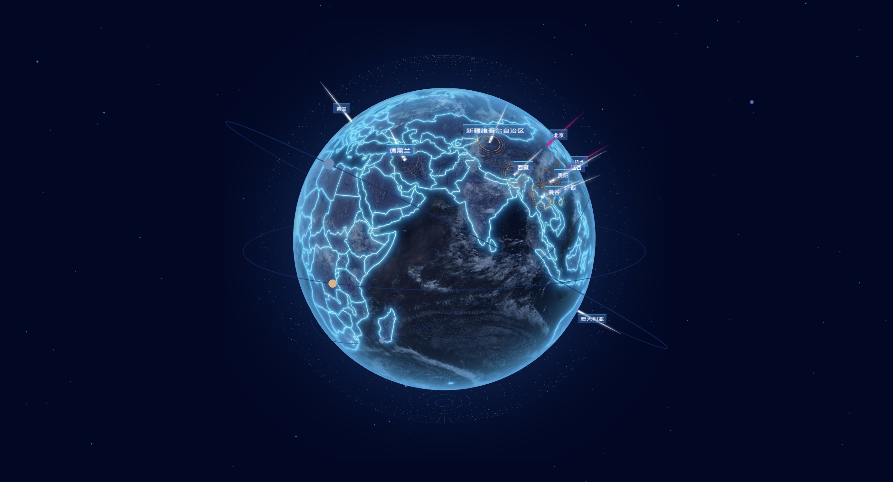

# 3d-earth
本项目使用 [three-ts-webpack](https://github.com/GhostCatcg/three-ts-webpack) 构建

[Live Demo](https://gcat.cc/demo/earth)

## Todolist
1. - [x] 加载效果[loading...]
2. - [x] 地球、以及星空背景🌏
3. - [x] 辉光以及大气层✨
4. - [x] 地球标点以及城市标签🇨🇳
5. - [x] 卫星环绕旋转🛰
6. - [x] 国家/城市之前的飞线🪐
7. - [ ] 飞机沿飞线飞行🛫

## 作者的其他 3D 项目

我的另一个 Web 3D 项目 [Tesla Wrap Design](https://tesla-wrap.design/) 可以在线设计 Tesla 车衣，并在 3D 车模上预览效果。
